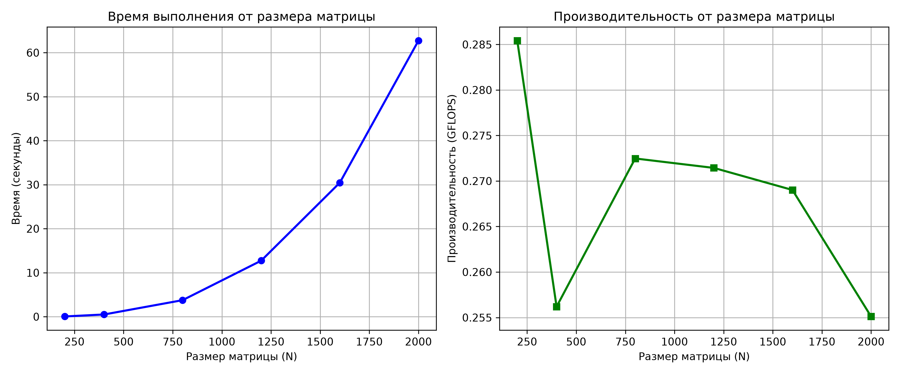

# Лабораторная работа №1: Последовательное умножение матриц

## 1. Цель работы
Реализация последовательного алгоритма умножения плотных квадратных матриц на C++, замер времени выполнения, автоматическая верификация через Python (NumPy) и исследование масштабируемости при росте размера $N$.

## 2. Аппаратная платформа
* **CPU:** Intel Core i5-10600KF @ 4.10 GHz (6 ядер / 12 потоков)
* **RAM:** 16 GB DDR4
* **ОС:** Windows 11 Pro, MSVC (C++23), Ninja

## 3. Результаты экспериментов
Алгоритм оптимизирован по кэшу (порядок обхода циклов $i \to k \to j$). Число операций: $2 \times N^3$.

| Размер ($N \times N$) | Время (сек) | Время (мс) | GFLOPS |
| :---: | :---: | :---: | :---: |
| **200** | 0.058 | 57.75 | 0.28 |
| **400** | 0.469 | 469.05 | 0.27 |
| **800** | 3.831 | 3830.97 | 0.27 |
| **1200** | 12.684 | 12684.41 | 0.27 |
| **1600** | 29.837 | 29837.40 | 0.27 |
| **2000** | 59.090 | 59090.31 | 0.27 |

## 4. Графики

## 5. Выводы
1. **Сложность $O(N^3)$ подтверждена:** при удвоении размера матрицы время вычислений возрастает примерно в 8 раз ($2^3 = 8$).
2. **Эффективность кэша:** порядок циклов $i \to k \to j$ обеспечивает постоянную производительность $\approx 0.27$ GFLOPS на всех размерах.
3. **Обоснование параллелизма:** время вычислений на $N = 2000$ составляет почти 1 минуту ($\approx 59.1$ с), что требует распараллеливания.