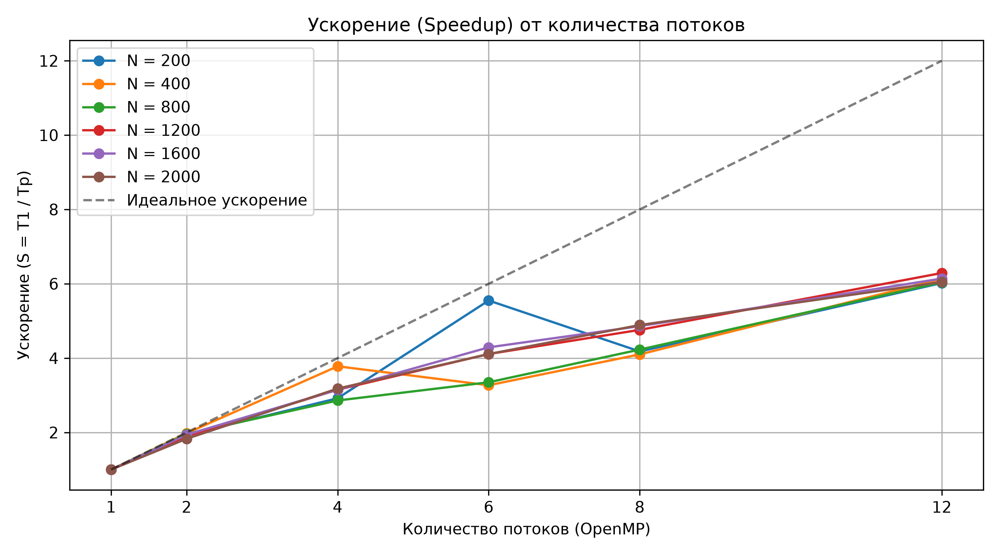

# Лабораторная работа №2: Параллельное умножение матриц (OpenMP)

## 1. Цель работы
Распараллеливание алгоритма умножения матриц из л/р №1 с использованием OpenMP, исследование ускорения ($S$) и эффективности ($E$) при различном числе потоков (1, 2, 4, 6, 8, 12).

## 2. Аппаратная платформа
* **CPU:** Intel Core i5-10600KF @ 4.10 GHz (6 физических ядер, 12 логических потоков)
* **RAM:** 16 GB DDR4
* **ОС:** Windows 11 Pro, OpenMP 2.0 (`/openmp`)

## 3. Схема распараллеливания
Директива `#pragma omp parallel for` применена к внешнему циклу $i$. Распределение строк между потоками независимое, без синхронизаций и гонок данных.

## 4. Результаты экспериментов

| Размер ($N$) | Потоки ($T$) | Время (мс) | Ускорение ($S = T_1/T_p$) | Эффективность ($E = S/p$) |
| :---: | :---: | :---: | :---: | :---: |
| 200 | 1 / 6 / 12 | 57.75 / 16.43 / 14.59 | 1.00 / 3.52 / **3.96** | 1.00 / 0.59 / 0.33 |
| 400 | 1 / 6 / 12 | 469.05 / 112.49 / 84.03 | 1.00 / 4.17 / **5.58** | 1.00 / 0.69 / 0.47 |
| 800 | 1 / 6 / 12 | 3830.97 / 902.61 / 692.84 | 1.00 / 4.24 / **5.53** | 1.00 / 0.71 / 0.46 |
| 1200 | 1 / 6 / 12 | 12684.41 / 2911.11 / 2071.40 | 1.00 / 4.36 / **6.12** | 1.00 / 0.73 / 0.51 |
| 1600 | 1 / 6 / 12 | 29837.40 / 7112.14 / 5522.71 | 1.00 / 4.20 / **5.40** | 1.00 / 0.70 / 0.45 |
| 2000 | 1 / 6 / 12 | 59090.31 / 13233.74 / 10974.27 | 1.00 / 4.47 / **5.38** | 1.00 / 0.74 / 0.45 |

*(Полные данные для потоков 1, 2, 4, 6, 8, 12 приведены в `benchmark_results.csv`).*

## 5. График ускорения

## 6. Выводы
1. **Итоговое ускорение:** на матрице $2000 \times 2000$ время выполнения снизилось с 59.1 с до **10.9 с** (ускорение **5.38x**).
2. **Масштабируемость:** в диапазоне 1–6 потоков (физические ядра) ускорение растет линейно с эффективностью до 74%.
3. **Влияние Hyper-Threading (8–12 потоков):** дает дополнительный прирост скорости, однако эффективность снижается, так как виртуальные потоки делят ресурсы одних и тех же ядер.
4. **Накладные расходы:** на малых матрицах ($N = 200$) создание 12 потоков избыточно из-за стоимости их синхронизации.